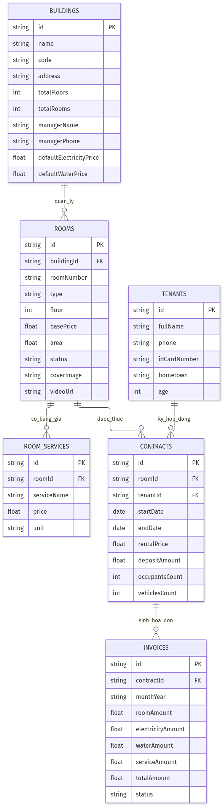
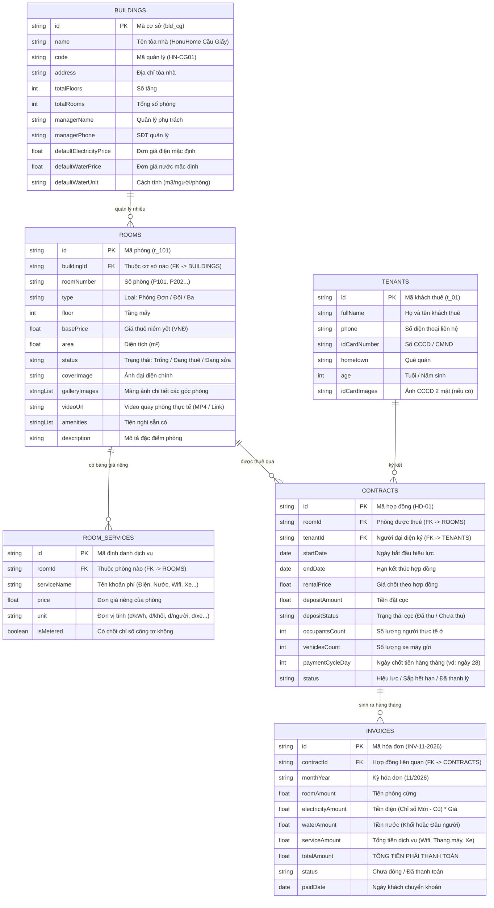
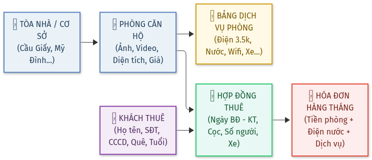
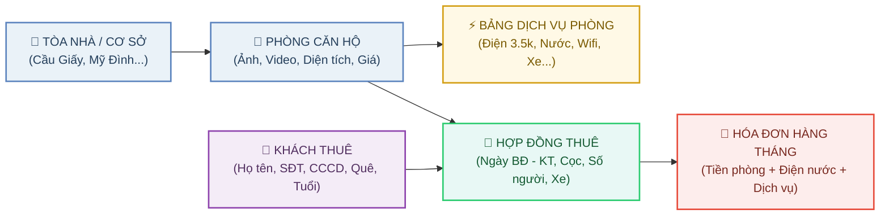

# HonuHome - Thiết Kế CSDL (ERD) & Luồng Vận Hành Nghiệp Vụ

Tài liệu thiết kế kiến trúc cơ sở dữ liệu và quy trình vận hành quản lý nhà trọ / chung cư mini **HonuHome**.

---

## 1. Sơ Đồ Thực Thể Quan Hệ (ERD)

### Mã Mermaid ERD:

---

## 2. Luồng Vận Hành Dữ Liệu Thực Tế

### Mã Mermaid Luồng:

---

## 3. Các Định Dạng Xuất File Trong Thư Mục `image/`

- **Sơ đồ ERD:**
  - `honuhome-erd.png` (Hình ảnh raster độ phân giải cao)
  - `honuhome-erd.svg` (Hình vector phóng to không vỡ nét)
- **Sơ đồ Luồng Vận Hành:**
  - `honuhome-luong-van-hanh.png`
  - `honuhome-luong-van-hanh.svg`
